# AuditGlimmer

**From inspection photographs to traceable collateral evidence.**
Meta **SAM 3.1** locates equipment in site photos. Meta **Muse Spark 1.3** reads what is printed on it as validated
JSON. **Deterministic rules**, not a model, match that evidence to a lender's asset register, and anything uncertain
goes to a named human reviewer.

Built for the Meta Global AI Developer Hackathon 2026 (Indie Developer track) · prototype, **not production-certified**.

[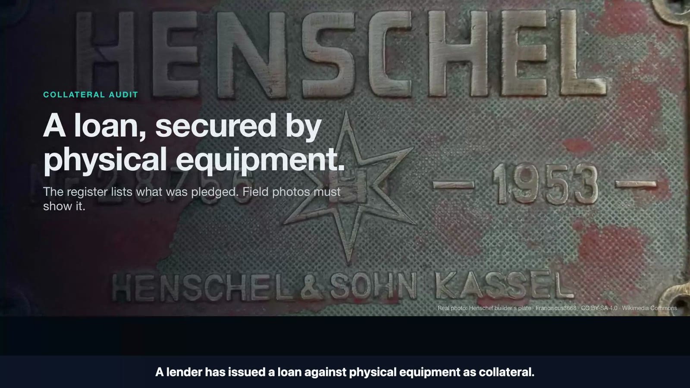](docs/demo-video.md)

▶ **Demo video (2:55):** `PLACEHOLDER: PUBLIC VIDEO URL` · scene list and live/replay/synthetic labels: [docs/demo-video.md](docs/demo-video.md)

## In 60 seconds

| | |
|---|---|
| **Problem** | A lender lends against physical equipment. The register says what was pledged; an inspector comes back with photos. Matching photos to register rows is manual, slow and error-prone: look-alike machines, worn or hidden serials, no audit trail. |
| **What it does** | Upload a register and photos, then: SAM 3.1 isolates each machine → Muse Spark 1.3 extracts maker, model, serial and its own uncertainty → rules propose register candidates with a named rule → a person confirms → a report traces every status to a photo, a model reading and a rule. |
| **Real Meta usage** | `sam-3.1` and `muse-spark-1.3` via the Meta Model API. **8 SAM + 54 Muse calls ≈ $0.35 estimated** across development, studies and the filmed live take, all logged with latency, tokens and cost ([evidence](#evidence-provenance-real-replayed-synthetic)). |
| **Best real result** | Live, on camera: Muse read **28756** from a real builder's plate, a second extraction agreed, and the rules reduced a **44-row test register to one candidate** (the planted look-alike `28765` was not offered). The decision is **PROBABLE, not VERIFIED**: a plate photo alone does not prove which machine carries it. |
| **Honest limits** | No real photo has been automatically verified yet. Studies are small (n = 14 and 26) with AI-made labels. See [Evaluation](#evaluation-honest-results). |

> AuditGlimmer records visual evidence. A readable serial is **not** proof of ownership, title, physical identity,
> condition or value, and an asset that was not photographed is **UNVERIFIED, not missing**.

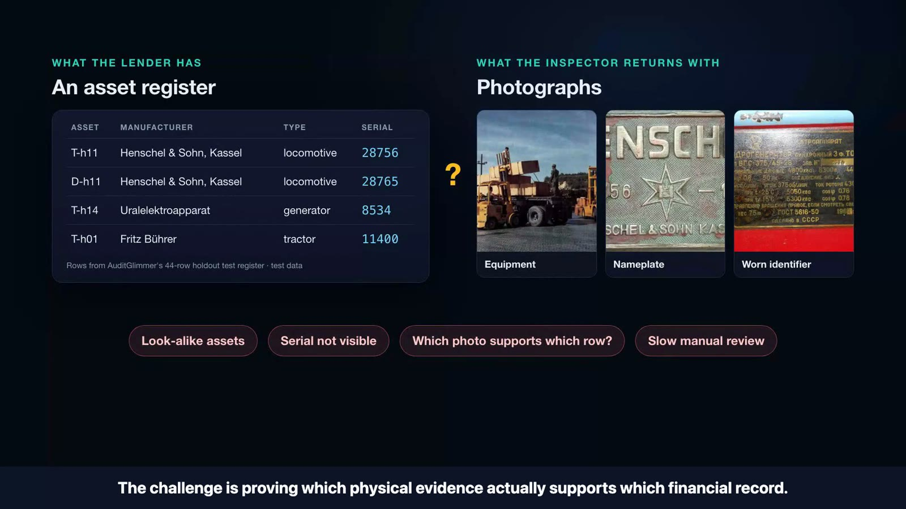

## How it works

Two genuine execution paths share one evidence schema, one rule engine and one audit trail.

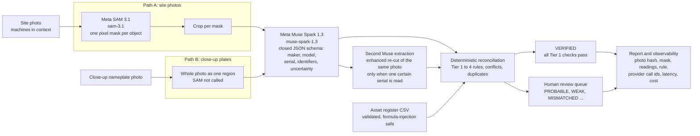

- **Muse never sees the register.** It reports only what is visible, so matching can't leak into reading.
- **Path B can never auto-verify.** A whole-photo region (or a SAM mask covering ≥ 90% of the frame) cannot show
  which physical unit carries the plate, so the best outcome is PROBABLE plus human review (rule `R2e_*`).
- **The second read is an experimental safeguard.** Two agreeing extractions are supporting evidence, not
  independent ground truth ([decisions D-16/D-17](docs/decisions.md)).

### System components

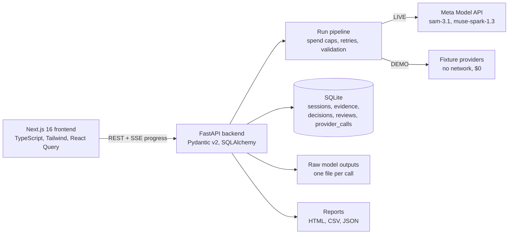

| Part | Where | What it does |
|---|---|---|
| API | `backend/app/main.py` | sessions, register upload, photo upload, runs (with SSE progress), extraction, reconciliation, reviews, report, trace |
| Pipeline | `backend/app/pipeline.py` | segment → crop → extract → second read; per-run, per-session and lifetime spend caps enforced before each call |
| Meta adapters | `backend/app/providers/sam_meta.py`, `muse_meta.py` | Meta Model API calls; responses validated against a closed schema; failures recorded, never silently replaced |
| Rules | `backend/app/reconcile.py` | deterministic tiers, conflict and duplicate detection, Tier 1 gate |
| Review | `/sessions/<id>/review` | confirm or reject with a reviewer name and required note; shown as *Human-confirmed*, never as machine verification |
| Observability | `/sessions/<id>/trace` | every provider call: model, status, latency, tokens, estimated cost, correlation id; evidence/provenance graph |
| Report | `backend/app/report.py` | HTML/CSV/JSON audit report linking each status to its evidence |

## Why Meta's models are essential here

- **SAM 3.1 turns one photo into per-machine evidence.** Yards hold look-alike machines side by side. Without
  instance masks there is no way to say *which* machine a reading came from, and the rule engine refuses to
  auto-verify anything that is not tied to one segmented object.
- **Muse Spark 1.3 reads like an inspector, and says when it can't.** It returns the maker, model and serial as
  structured fields, separates the serial from other printed numbers, and records per-field uncertainty
  ("serial not visible", "best reading 3554"). The rules use that uncertainty: an uncertain serial is never
  matched automatically.
- **Measured contribution (retrospective):** on the 14-photo holdout, the same rules without Muse's readings
  offered the correct single register row for **0 of 6** legible plates; with Muse, **5 of 6**. These are
  review candidates, not automatic verifications ([holdout-arms.json](eval/results/holdout-arms.json)).

## Product walkthrough

| | |
|---|---|
| 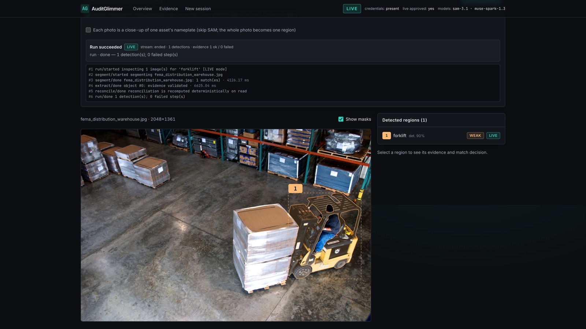 | **1. Live SAM 3.1.** A real FEMA warehouse photo, concept "forklift": one mask returned (4.1 s). |
| 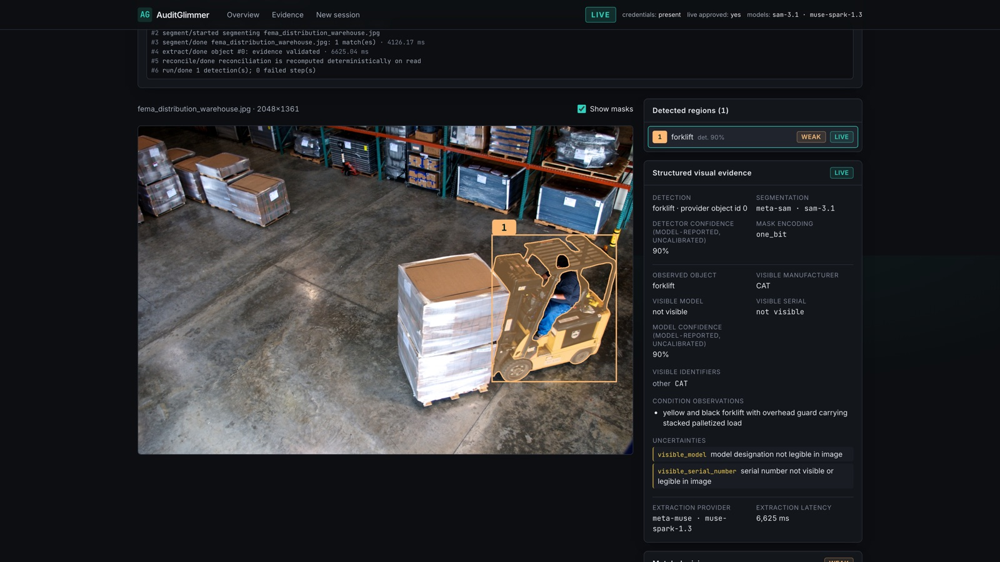 | **2. Live Muse Spark 1.3 inside the mask.** Maker `CAT`; serial `not visible`, with the reason recorded. No guessing. |
| 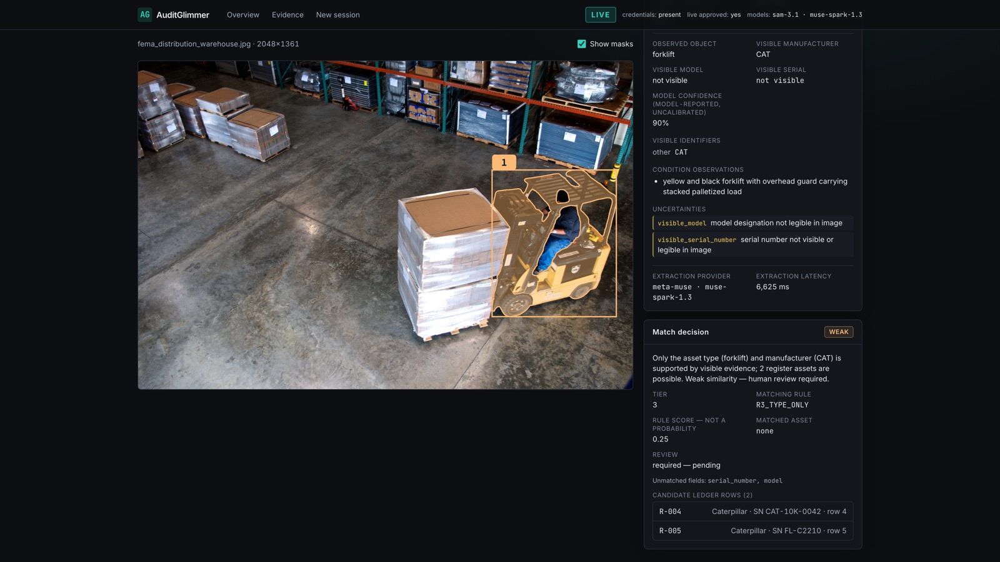 | **3. Rules.** Two Caterpillar forklifts are on the demonstration register, so the result is **WEAK** and goes to a person. |
| 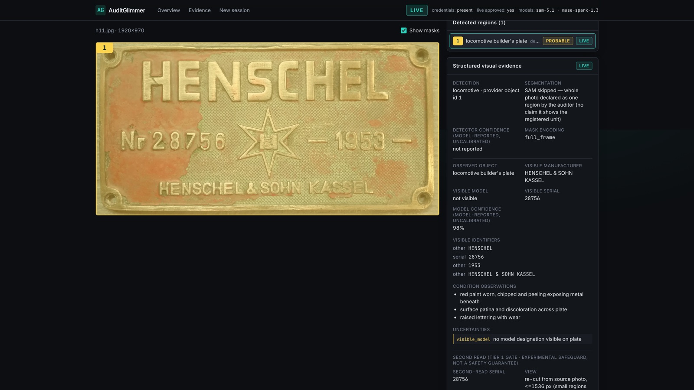 | **4. Live, Muse only (SAM not called).** A close-up builder's plate: serial `28756`. A second extraction of an enhanced view agrees. |
| 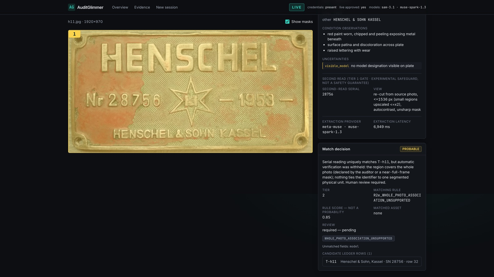 | **5. One candidate from 44 test-register rows**, **PROBABLE**, with rule `R2e_WHOLE_PHOTO_ASSOCIATION_UNSUPPORTED` and an examiner required. |
| 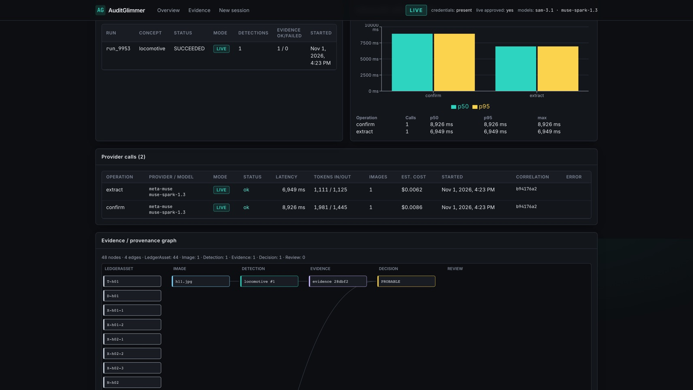 | **6. Audit trail.** Every call on record: model, latency, tokens in/out, estimated cost, correlation id. |
| 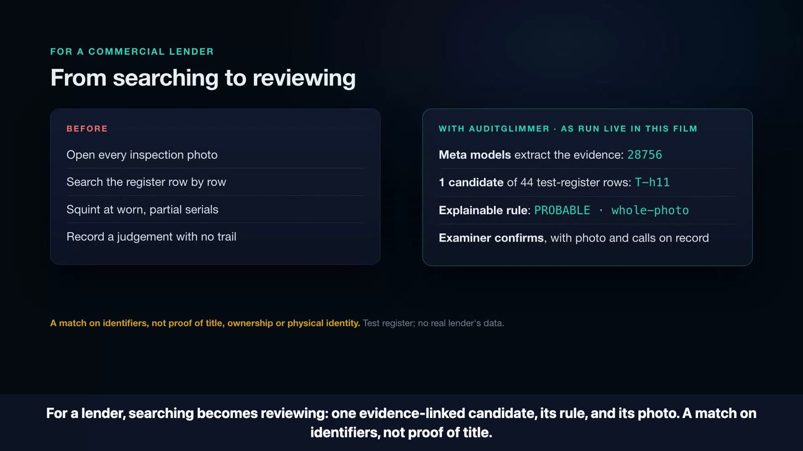 | **7. The payoff.** The examiner's job changes from searching every photo against every row to reviewing one evidence-linked candidate. |

All seven screens come from the filmed live take on 1 Nov 2026 (recorded once; see [demo-video.md](docs/demo-video.md)).

## Evidence provenance: real, replayed, synthetic

| Label | Meaning | Where |
|---|---|---|
| **Live** | A Meta Model API call made by the app | 4 calls filmed 1 Nov 2026: [calls.json](eval/results/live-film-2026-11-01/calls.json) + [raw outputs](eval/results/live-film-2026-11-01/raw/) |
| **Replay** | Stored outputs of earlier real calls, shown again without calling a model | holdout: [holdout-study-raw/](eval/results/holdout-study-raw/) · 26-photo study: [muse-study-raw/](eval/results/muse-study-raw/) · first live journey: [live-journey/](eval/results/live-journey/) |
| **Synthetic** | Hand-made fixture images and outputs; no model involved | `fixtures/images/`, DEMO mode, the "evidence challenge" Tier 1 example |
| **Test data** | Registers written for testing, never a real lender's records | `fixtures/real/ledger_real.csv`, `fixtures/holdout/ledger_holdout.csv` (decoy rows planted on purpose) |

**Recorded live footprint: 8 SAM 3.1 + 54 Muse Spark 1.3 calls ≈ $0.3455 estimated.** That is 7 SAM + 53 Muse
($0.3373) in the app's `provider_calls` table plus 1 SAM + 1 Muse from earlier standalone scripts
([live-muse-nameplate.json](eval/results/live-muse-nameplate.json)). Estimates use Meta's published prices; the
Meta console bill is authoritative.

## Evaluation: honest results

Three result sets are kept separate and never pooled. All labels are AI-made (two AI readers, sealed before each
run), not independent human ground truth.

| Set | Method | Result |
|---|---|---|
| **Fresh holdout**, 14 photos | protocol and labels frozen and hashed before the run ([protocol](docs/holdout-study-protocol.md), [results](docs/holdout-study-results.md)); independently re-computed | exact serial on legible plates **5/6** (95% CI 44–97%); correct single candidate **5/6**; automatic verifications **0**, by design (whole-photo plates cannot verify), so **safety is not yet measured**; 19 Muse calls, $0.12 |
| **Holdout arms**, retrospective | same stored outputs re-scored under three rule sets (not pre-registered) | rules only 0/6 · + Muse 5/6 · + Muse + second read 5/6 at +42% cost; the second read caught nothing on this set |
| **Historical study**, 26 photos | pre-registered ([protocol](docs/muse-study-protocol.md), [results](docs/muse-study-results.md)) | exact serial 11/16 (69%, below the 70% bar); 0 invented serials on 8 negatives; **1 automatic verification of a reading the labellers disputed (5735 vs 5765): safety gate FAILED**. This led to the second read and the whole-photo rule. |
| **Fixture regression** | DEMO mode, `eval/run_eval.py` | 18/18 asset statuses; 0 false automatic matches (measures the rules, not the models) |

Known weaknesses: n is small; one image source (Wikimedia Commons); 3 of the 5 correct holdout candidates reach
the reviewer labelled MISMATCHED, because the test register's long maker names don't prefix-match the read
(safe direction, not corrected after the fact); the second read has never been seen catching a real disagreement.

## Run it (safe DEMO mode by default)

Requirements: [uv](https://docs.astral.sh/uv/) (it fetches Python 3.13) and Node 20.17+ or 22.9+. Run all commands
from the repository root.

```bash
uv sync --project backend
```

```bash
npm --prefix frontend ci
```

Start the API in DEMO mode (fixture providers, no network, $0). Both variables are set explicitly on purpose, so a
local `.env` can't switch you into paid mode:

```bash
AUDITGLIMMER_MODE=demo AUDITGLIMMER_LIVE_APPROVED=0 uv run --project backend uvicorn app.main:create_app --factory --app-dir backend --host 127.0.0.1 --port 8000
```

Start the UI in a second terminal:

```bash
npm --prefix frontend run dev
```

Open http://localhost:3000 → **Start guided demo** (or **New session**, facility `WH-01` → **Load demo dataset**) →
**Visual inspection** → **Reconciliation** → **Review queue** → **Report** → **Observability**.

A fresh clone has no recorded live sessions, because `backend/data/` (SQLite and uploads) is git-ignored. The overview
then lists no live evidence, and **Evidence challenge** says "No recorded live SAM + Muse evidence is stored here"
(its labelled DEMO case still works). Demo runs finish as `partial` on purpose: the fixtures include malformed and
timed-out provider responses. Real model outputs ship as files under `eval/results/`, and replaying or making live
calls needs your own Meta Model API key (LIVE mode below).

### Tests and evaluation

```bash
uv run --project backend pytest -q -p no:logging
```

```bash
uv run --project backend python eval/run_eval.py
```

```bash
cd e2e && npm ci && npx playwright install chromium && npx playwright test
```

The browser suite expects both servers running.

### LIVE mode (paid; read [docs/cost-control.md](docs/cost-control.md) first)

LIVE needs all three: `AUDITGLIMMER_MODE=live`, a `MODEL_API_KEY` and `AUDITGLIMMER_LIVE_APPROVED=1`. Otherwise
runs return `403 LIVE_NOT_APPROVED`; there is never a silent fallback to fixtures. Spend caps per run, per session
and lifetime are enforced before every call. The key is read from the environment, never logged, and never returned
by the API (`/api/config` exposes only `credentials_present`). See [.env.example](.env.example).

## How matching works

| Outcome | Rule | Automatic? |
|---|---|---|
| VERIFIED (Tier 1) | serial uniquely equals one register serial; maker or model corroborates; nothing conflicts; a second Muse extraction agrees; region segmented on the equipment (never a whole-photo plate); no standalone-plate description | yes |
| PROBABLE (Tier 2) | maker + model match, or the serial is uncertain, duplicated or seen on 2+ objects, or a Tier 1 check failed (`R2e_*`, reason shown) | human review |
| WEAK (Tier 3) | asset type (± maker) only | human review |
| MISMATCHED | identifiers conflict (serial vs model, maker or facility) | human review |
| NOT_IN_REGISTER (Tier 4) | object with no supported register match | human review |
| EVIDENCE_UNUSABLE | extraction failed validation or timed out | — |

Asset statuses: VERIFIED, PROBABLE, MISMATCHED, UNVERIFIED (inspected, no adequate evidence), NOT_OBSERVABLE (not
covered), Human-confirmed. `AUDITGLIMMER_TIER1_POLICY=human_review` sends every match to a person.

## Hackathon contributions, attribution and licensing

- **Built during the event window** (Oct 26 – Nov 4, 2026): the project folder and all code were created on
  31 Oct 2026, and the git history runs 31 Oct – 1 Nov ([compliance notes](docs/hackathon-compliance.md)).
  No code was reused from earlier projects.
- **Author:** Shroddha Ghosh (indie entry). Development used an AI coding assistant (Claude Code), disclosed for
  transparency. The demo video was produced with [Ultrademo](https://github.com/new-xp/ultrademo) (Apache-2.0),
  narrated with the local Kokoro TTS voice.
- **Meta models:** SAM 3.1 and Muse Spark 1.3 via the Meta Model API. `meta-sam-parser` is used under the SAM License.
- **Photos:** Wikimedia Commons, public domain / CC0 / CC BY / CC BY-SA with attribution:
  [fixtures/real/LICENSES.md](fixtures/real/LICENSES.md), [fixtures/study/LICENSES.md](fixtures/study/LICENSES.md),
  [fixtures/holdout/LICENSES.md](fixtures/holdout/LICENSES.md). Overlays and crops of CC BY-SA photos (e.g. the
  Henschel plate, Franciscus3668, CC BY-SA 4.0) remain CC BY-SA 4.0. Synthetic fixtures: CC0.
- **Code licence:** Apache-2.0 ([LICENSE](LICENSE), [NOTICE](NOTICE)). Third-party photos and dependencies keep their own licences.

## Repository map

| Path | Contents |
|---|---|
| `backend/app/` | FastAPI app, pipeline, rules, Meta and fixture providers, ledger validation, security, report |
| `backend/tests/` | 144 pytest tests: journeys, rules, Tier 1 gate, provider contracts and failure modes, input security |
| `frontend/` | Next.js 16 + TypeScript + Tailwind 4 + React Query + Recharts |
| `e2e/` | Playwright browser tests |
| `fixtures/` | synthetic images, test registers, real photo sets with licences |
| `eval/` | evaluation harness, study scripts, stored results and raw model outputs |
| `docs/` | [architecture](docs/architecture.md), [decisions](docs/decisions.md), [ontology](docs/ontology.md), [cost control](docs/cost-control.md), [security](docs/security.md), [submission](docs/submission-final.md) |
