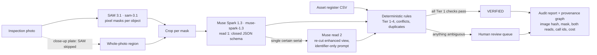

# AuditGlimmer

Visual-financial reconciliation for physical collateral audits: segment equipment in inspection
photos with **SAM 3.1**, record visible identifiers with **Muse Spark** as validated JSON, and
reconcile them against an asset register with a **deterministic, explainable** matching engine.
Humans review every ambiguous match; the audit report links each decision to its raw evidence.

> AuditGlimmer records visual evidence. A photo does not prove ownership, authenticity, condition
> or value, and an asset that was not photographed is **UNVERIFIED — not missing**.

| Status | |
|---|---|
| DEMO mode (fixture providers, synthetic images, $0) | working end to end, tested |
| LIVE mode (Meta Model API: `sam-3.1`, `muse-spark-1.3`) | exercised on real photos: 7 SAM + 51 Muse calls ≈ $0.3235 recorded (see `docs/submission-final.md`) |
| Two-read Tier 1 gate | ran live in the holdout (5 second reads, 5 agreed); never yet seen catching a real disagreement — experimental safeguard |
| Fresh holdout study | run 31 Oct, independently verified (`docs/holdout-study-results.md`) |
| Production | **prototype — not production-certified** |

**First 30 seconds:** open http://localhost:3000/challenge — one recorded-live SAM 3.1 + Muse Spark case that the
rules sent to a human, next to one labelled DEMO match, each panel naming its source.

## The problem

Lenders and insurers keep registers of pledged equipment. Checking them means site visits, reading nameplates and
hand-reconciling spreadsheets. An AI tool that guesses serials, "verifies" from a logo or calls an unphotographed
asset missing is worse than none. AuditGlimmer lets the models do what they are good at and keeps the decision
deterministic and reviewable.

## Architecture



Tier 1 (automatic VERIFIED) needs: a unique register serial; two consistent Muse reads; a manufacturer or model
that corroborates; no contradictory evidence; and a segmented region on the equipment — a whole-photo plate or a
near-full-frame mask never establishes which unit it belongs to. Muse never sees the register. Rationale: D-16/D-17
in `docs/decisions.md`.

## Tested results (kept separate; all labels AI-made, small n)

| Set | What | Key numbers |
|---|---|---|
| Historical, pre-registered (26 photos) | `docs/muse-study-results.md` | serial exact 11/16 (69%); 0 invented serials; **1 unsafe verification (s14) — safety gate failed** |
| Post-hoc (same 26) | engine changes after seeing outputs | correct auto-verifications 3/14 → 7/14 (optimistic; now impossible for whole-photo items) |
| Fresh holdout (14 new photos, frozen before the run) | `docs/holdout-study-results.md`, independently verified | serial exact 5/6; **0 unsafe**, 0 auto-verifications (by design); correct single suggestion 5/6; second reads 5/5 agreed; $0.12 |
| Holdout arms (post-hoc, same outputs) | `eval/results/holdout-arms.json` | no Muse: 0/6 suggestions · Muse: 5/6 · Muse + gate: 5/6 at +42% cost; the gate caught nothing on this set |
| Fixture regression (DEMO) | `eval/run_eval.py` | 18/18 asset statuses; 0 false automatic matches |

Reproduce offline: `uv run --project backend python eval/run_eval.py` (fixtures) and
`uv run --project backend python eval/holdout_arms.py` (needs the API serving the stored holdout session).

## Meta model usage — evidence

Model ids are pinned in `backend/app/config.py`: `sam-3.1` (segmentation) and `muse-spark-1.3` (structured visual
evidence), Meta Model API `https://api.meta.ai/v1`. Every live call is a `provider_calls` row (model, operation,
latency, tokens, estimated cost, raw-output file) shown on each session's **Observability** page. Recorded total:
**7 SAM + 51 Muse calls ≈ $0.3235**. Raw holdout outputs: `eval/results/holdout-study-raw/`.

## Protected demo (not deployed; instructions only)

Use `deploy/demo.env.example`: `AUDITGLIMMER_MODE=demo`, `AUDITGLIMMER_LIVE_APPROVED=0`, **no `MODEL_API_KEY`
on any shared host**, and `AUDITGLIMMER_ACCESS_CODE` (≥ 24 characters) so every `/api/*` request needs the
`X-Access-Code` header (the UI prompts for it). Recorded live sessions replay from stored outputs; no model is called.

## Licences

Code: owner to choose before publishing. Photos: `fixtures/real/LICENSES.md`, `fixtures/study/LICENSES.md`,
`fixtures/holdout/LICENSES.md` (CC0 / public domain / CC BY / CC BY-SA, with attribution; derivatives of CC BY-SA
photos, such as overlays and second-read views, stay CC BY-SA).

## Quick start (macOS, Apple Silicon)

Requirements: [uv](https://docs.astral.sh/uv/) (Python 3.13 is fetched automatically), Node 20.17+ / 22.9+.

```bash
cd auditglimmer/backend && uv sync
```

```bash
cd auditglimmer/frontend && npm ci
```

Start the API (DEMO mode, port 8000):

```bash
cd auditglimmer && AUDITGLIMMER_MODE=demo uv run --project backend uvicorn app.main:create_app --factory --app-dir backend --host 127.0.0.1 --port 8000
```

`AUDITGLIMMER_MODE=demo` is explicit on purpose: a local `.env` may set live mode.

Start the UI (port 3000) in a second terminal:

```bash
cd auditglimmer/frontend && npm run dev
```

Open http://localhost:3000 → **New session** (facility `WH-01`) → **Load demo dataset** →
**Visual inspection**: run `industrial generator`, then `forklift` → **Reconciliation** →
**Review queue** → **Report** → **Observability**. Walkthrough: [docs/demo-script.md](docs/demo-script.md).

## Tests and evaluation

```bash
cd auditglimmer/backend && uv run pytest -q -p no:logging
```

```bash
cd auditglimmer && uv run --project backend python eval/run_eval.py
```

```bash
cd auditglimmer/e2e && npm ci && npx playwright install chromium && npx playwright test
```

(The browser suite expects both servers running.) Regenerate fixtures:
`uv run --project backend python scripts/make_fixtures.py`.

## LIVE mode (paid — read [docs/cost-control.md](docs/cost-control.md) first)

```bash
export AUDITGLIMMER_MODE=live MODEL_API_KEY=... AUDITGLIMMER_LIVE_APPROVED=1
```

Without the key or approval, live runs return `403 LIVE_NOT_APPROVED`; there is never a silent
fallback to fixtures. Smoke test (≈ $0.04 worst case, refuses without `--i-approve-spend`):

```bash
cd auditglimmer && uv run --project backend python scripts/live_smoke.py --i-approve-spend
```

## How matching works

| Outcome | Rule | Auto? |
|---|---|---|
| VERIFIED (Tier 1) | readable serial uniquely equals one ledger serial; no conflicting mfr/model/type/facility; a second independent Muse read agrees and does not contradict the register; manufacturer or model corroborates; region segmented on the equipment (never a whole-photo plate); no standalone-plate description | yes |
| PROBABLE (Tier 2) | mfr+model match, or serial uncertain / duplicated in ledger / seen on 2+ objects, or a Tier 1 gate check failed (rule `R2e_*`, reason in the explanation) | review |
| WEAK (Tier 3) | asset type only | review |
| MISMATCHED | identifiers conflict (serial vs model, manufacturer, facility) | review |
| NOT_IN_REGISTER (Tier 4) | observed object with no supported register match | review |
| EVIDENCE_UNUSABLE | extraction failed validation / timed out | — |

Two agreeing reads are supporting evidence, not proof (D-16/D-17 in `docs/decisions.md`). `AUDITGLIMMER_TIER1_POLICY=human_review` sends every match to a person.

Asset statuses: VERIFIED, PROBABLE, MISMATCHED, UNVERIFIED (inspected, no adequate evidence),
NOT_OBSERVABLE (not covered by any inspection).

## Repository map

| Path | Contents |
|---|---|
| `backend/app/` | FastAPI app: `main.py` routes, `pipeline.py` run worker, `reconcile.py` engine, `providers/` (Meta + fixture adapters), `ledger.py`, `security.py`, `report.py`, `services.py`, `db.py`, `schemas.py` |
| `backend/tests/` | pytest: journey, reconciliation rules, provider contracts and failure modes, input security |
| `frontend/` | Next.js 16 + TypeScript + Tailwind 4 + React Query + Recharts |
| `e2e/` | Playwright browser tests (independent verifier) |
| `fixtures/` | synthetic CC0 images, ledger CSV, labelled manifest |
| `eval/` | evaluation harness and results |
| `scripts/` | fixture generator, gated live smoke test |
| `docs/` | [task graph](docs/task-graph.md), [architecture](docs/architecture.md), [ontology](docs/ontology.md), [decisions](docs/decisions.md), [contracts](docs/integration-contracts.md), [evaluation plan](docs/evaluation-plan.md) / [report](docs/evaluation-report.md), [cost control](docs/cost-control.md), [security](docs/security.md), [demo script](docs/demo-script.md), [submission draft](docs/submission-draft.md) |

## Configuration

See [.env.example](.env.example). Data (SQLite + uploads + raw provider outputs) lives in
`backend/data/` (git-ignored). Delete a session from the API to remove its rows and images.

## Licence notes

Fixtures: CC0 (generated). `meta-sam-parser` is distributed under the SAM License.
