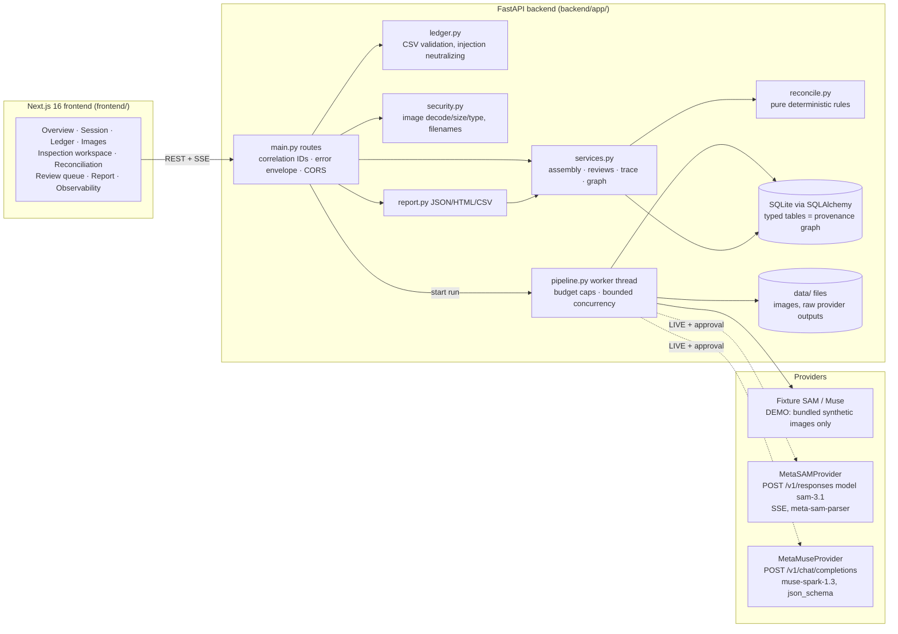

# Architecture

## Request flow (one inspection)

1. `POST /api/sessions/{id}/runs {concept}` → validates concept (short noun phrase, no markup),
   creates `Run`, starts a worker thread (max 2 concurrent runs).
2. Per image: `segment_image()` → masks normalized to half-open source-pixel bounds plus a raster
   that maps exactly onto the bounds (verified against the documented SAM 3.1 wire example).
3. Per detection: crop (bounds + 8% padding, ≤1024 px JPEG) → `extract_visual_evidence()` →
   Pydantic validation → `Evidence` row with server-attached `evidence_references`.
4. Every provider request → `ProviderCall` row (latency, tokens, estimated cost, raw output file).
5. Progress events are persisted; `GET /api/runs/{id}/events` streams them over SSE.
6. Reconciliation is a pure function recomputed on every read, so reviews and re-runs can never
   leave stale derived state.

## Mode handling

| | DEMO | LIVE |
|---|---|---|
| Segmentation | `FixtureSAMProvider` (authored labels) | `MetaSAMProvider` (`sam-3.1`) |
| Extraction | `FixtureMuseProvider` (authored labels + failure cases) | `MetaMuseProvider` (`muse-spark-1.3`) |
| Unknown image | explicit `no_fixture` error | real call |
| Missing key / approval | n/a | `403 LIVE_NOT_APPROVED`, providers report unhealthy |
| Fallback | none | none — never substitutes fixtures |

## Verified Meta API facts (2026-10-31, dev.meta.ai docs)

- Base URL `https://api.meta.ai/v1`, `Authorization: Bearer $MODEL_API_KEY`.
- SAM 3.1: model `sam-3.1`, Responses API, streamed special-token text
  `<0f>id<|box;...|><|mask;...;data=H,W,<enc>base85|>`; zero matches = empty output (valid);
  `metadata.include_confidence: "true"`, `metadata.mask_encoding: "one_bit"`; official parser
  `meta-sam-parser` 0.1.0 (SAM License). $2.50 / 1,000 images; 3,000 RPM.
- Muse Spark: `muse-spark-1.3` (Standard mode, content not used for training);
  Chat Completions `response_format: {type: json_schema}` constrains decoding; `reasoning_effort`
  `"low"`; reasoning tokens share `max_completion_tokens`, so `finish_reason=length` is treated as
  invalid output. $1.25 / 1M input, $4.25 / 1M output.
- Verified live 2026-10-31: SAM 3.1 accepts a base64 `data:` URL in `input_image.image_url`
  (`usage.images_processed: 1`). The live stream emits no `output_text.delta` for an empty result;
  text arrives in `output_text.done` / `content_part.done`, which the adapter reads.

## Not built (deliberately)

Kubernetes, queues, Redis, Neo4j, GraphRAG, Docker Compose (two local processes suffice; a compose
file adds nothing for a single-machine demo). Video tracking (SAM 3.1 supports it; out of MVP scope).
OCR beyond Muse transcription (would need its own evaluation).
