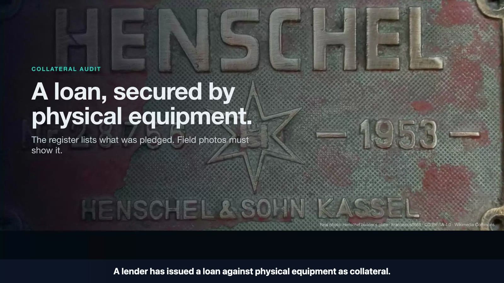

# AuditGlimmer demo video

**Hosted link:** [https://youtu.be/xvGoop1LOUE](https://youtu.be/xvGoop1LOUE) (YouTube, unlisted)
Local master: `submission/AuditGlimmer_Meta_Final.mp4`. It is 174.9 s at 1920×1080, SHA-256 `02c22ab7…ad615`. The file is not committed, because video masters are git-ignored for size.
Verification record: [submission/VERIFICATION-META-FINAL.md](../submission/VERIFICATION-META-FINAL.md).

## What you see, and what is real

| Time | Scene | Source |
|---|---|---|
| 0:00–0:24 | Lender problem: register vs field photographs | designed explainer using real photos and test-register rows |
| 0:24–0:37 | AuditGlimmer architecture card | explainer |
| 0:37–1:16 | Warehouse photo: upload → **SAM 3.1** mask → **Muse Spark 1.3** reads `CAT`, serial "not visible" → **WEAK** | **live Meta calls**, recorded 1 Nov 2026 |
| 1:16–1:24 | Test register with a planted look-alike (`28756` vs `28765`) | test data, labelled |
| 1:24–2:06 | Close-up plate, **Muse only (SAM not called)**: `28756`, second extraction agrees → 1 of 44 rows → **PROBABLE** → provider-call trail | **live Meta calls**, recorded 1 Nov 2026 |
| 2:06–2:16 | Before/after for a commercial lender | explainer |
| 2:16–2:29 | Retrospective 0/6 vs 5/6 comparison, with methodology | stored study data |
| 2:29–2:39 | What automatic VERIFIED requires | synthetic fixture, labelled |
| 2:39–2:55 | Honest numbers and end card | stored data and today's call log |

The live take made 4 calls (1 `sam-3.1` + 3 `muse-spark-1.3`, ≈ $0.022 estimated), listed with their raw outputs in
[eval/results/live-film-2026-11-01/](../eval/results/live-film-2026-11-01/calls.json). It was captured exactly once.
Editorial re-renders reuse that footage and never call a model. Waiting time during the runs is cut and marked
"time-compressed" on screen. Narration is a local TTS voice.
