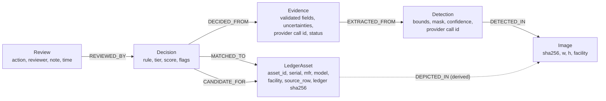

# Ontology and Evidence Provenance (graph-engineering, knowledge-graph discipline)

## Stage 1 — scope and value test: is a graph worth it?

| Question | Answer for AuditGlimmer MVP |
|---|---|
| Multi-hop queries? | One fixed chain: Asset ← Decision ← Evidence ← Detection ← Image. Always the same depth. |
| Entities recurring across sources? | Yes (one asset in several photos), but resolved by deterministic identifier keys. |
| Relationships *are* the data? | Partly: the provenance chain is the audit trail. |

Verdict: **typed relational tables with foreign keys** are the graph. The chain is fixed-depth, so
SQL joins answer every query; Neo4j would add an operational dependency with no query it can do
that SQLite cannot. GraphRAG is not used: the vision model never needs ledger context (and must not
see financial data). The graph is still exposed as typed nodes/edges at
`GET /api/sessions/{id}/evidence-graph` for audit traversal in the UI.

**Revisit trigger** (measured, not speculative): cross-session identity resolution (the same asset
audited across many facilities/years, variable-depth "where else was this serial seen") — then
add a `asset_identity` node table + `SAME_AS` edges, still in PostgreSQL first.

## Stage 2 — representation

Property graph in SQLite (`backend/app/db.py`), PostgreSQL-compatible via SQLAlchemy URL.
Every fact carries provenance: source (file sha256 / provider call id), timestamp, and confidence
(provider-reported, uncalibrated) where one exists.

## Stage 3 — minimal typed ontology (6 node types, 7 edge types)

Domain/range checks are structural: foreign keys make an edge with the wrong endpoint type
unrepresentable. `ProviderCall` and `RunEvent` are trace records, not ontology nodes.

## Stages 4–7 — extraction and quality gate

- Entity extraction is done by Muse Spark into a closed schema (`ModelEvidence`, extra keys
  forbidden). Relation extraction is **not** delegated to a model: every edge is created by code.
- Quality gate = Pydantic validation; invalid output becomes `Evidence(status=invalid)` and never
  reaches matching.

## Stage 8 — fusion (identity resolution)

Deterministic, in `reconcile.py`:

1. **Blocking**: same facility (identifier matches are global so cross-facility serials are caught
   as `FACILITY_MISMATCH`).
2. **Matching layers**: normalized serial (uppercase, separators stripped, ≥4 chars) → manufacturer
   + model → canonical asset type (synonym table).
3. **Merge policy**: auto-merge (VERIFIED) only for a unique, readable, non-conflicting serial.
   Everything ambiguous goes to the human queue; conflicting values are kept as flags, never
   overwritten. Duplicate identifiers on several detected objects block auto-verification
   (`DUPLICATE_IDENTIFIER_OBSERVATION`). An erroneous merge is worse than a missed one.

## Stage 9 — serving

No LLM reasoning over the graph. The optional `explain` endpoint receives only the decision's own
deterministic facts, fenced as data.
