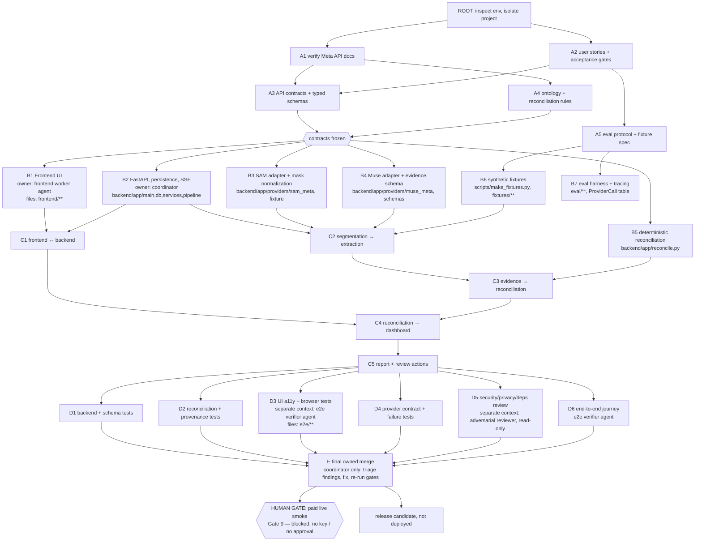

# Task Graph (graph-engineering, task-graph discipline)

Method: [codejunkie99/graph-engineering](https://github.com/codejunkie99/graph-engineering)
`references/task-graphs.md` — draw an edge only when a job reads another job's *result*; delete
fake edges; diamond pattern (parallel workers → separate-context verify → single owned merge);
one writer per file; bounded loops; human gate only on irreversible edges.

## DAG as executed

## Fake edges deleted

| Assumed sequence | Why it is fake | Effect |
|---|---|---|
| "build backend, then frontend" | the frontend reads the *contract*, not the backend's code | B1 ran in parallel with B2–B5 |
| "write SAM adapter, then fixtures" | fixtures read the fixture spec (A5), not the adapter | B6 ran independently of B3 |
| "verify UI after security review" | D3/D5 read the merged code, not each other | D3, D5 ran concurrently |
| "reconcile after extraction finishes (stored)" | reconciliation reads persisted evidence, not the run | reconciliation is recomputed on read; no edge from the run worker |

Kept real edges: contracts → all B nodes; B2+B3+B4 → C2; everything → E.

## Parallelism actually used (stop rule)

Split only where work never reads sibling results:

- **B1** frontend → one worker agent, exclusive owner of `frontend/**`.
- **B2–B7** backend → coordinator, sequential (they share types and the run worker: splitting would
  have been the "sequential work" case the stop rule warns against).
- **D3+D6** browser verification → separate agent, exclusive owner of `e2e/**`.
- **D5 (+D2, D4 review)** → separate adversarial agent, read-only.
- D1/D2/D4 automated tests were written by the coordinator; the adversarial agent re-checks them
  from a different context.

Spawn cap: 3 agents total. One writer per file enforced by directory ownership.

## Guardrails

- Max 3 repair attempts per failing gate before marking it blocked.
- Paid inference gated by env (`AUDITGLIMMER_LIVE_APPROVED=1`), a CLI flag for the smoke script,
  per-run request and USD caps (`pipeline.Budget`).
- No commits, pushes, deploys or submissions without the user.
